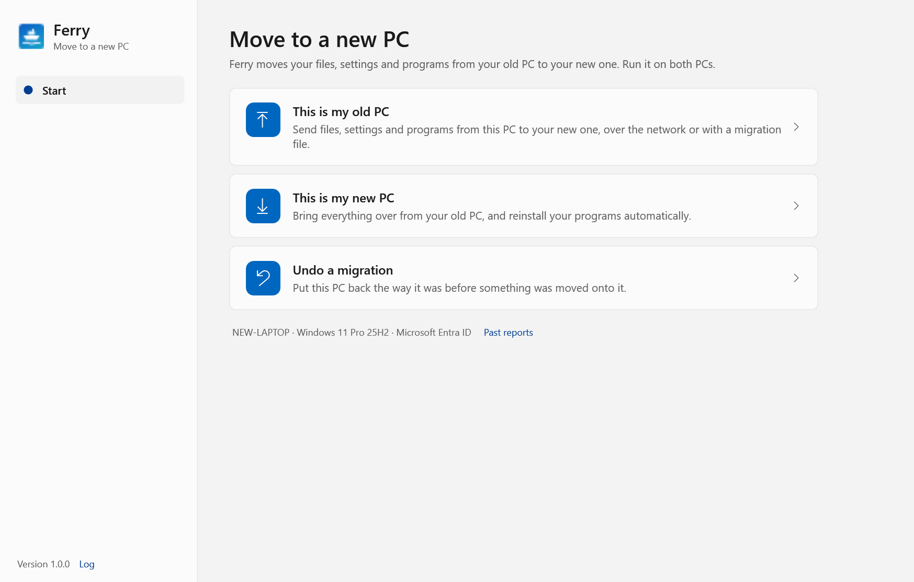
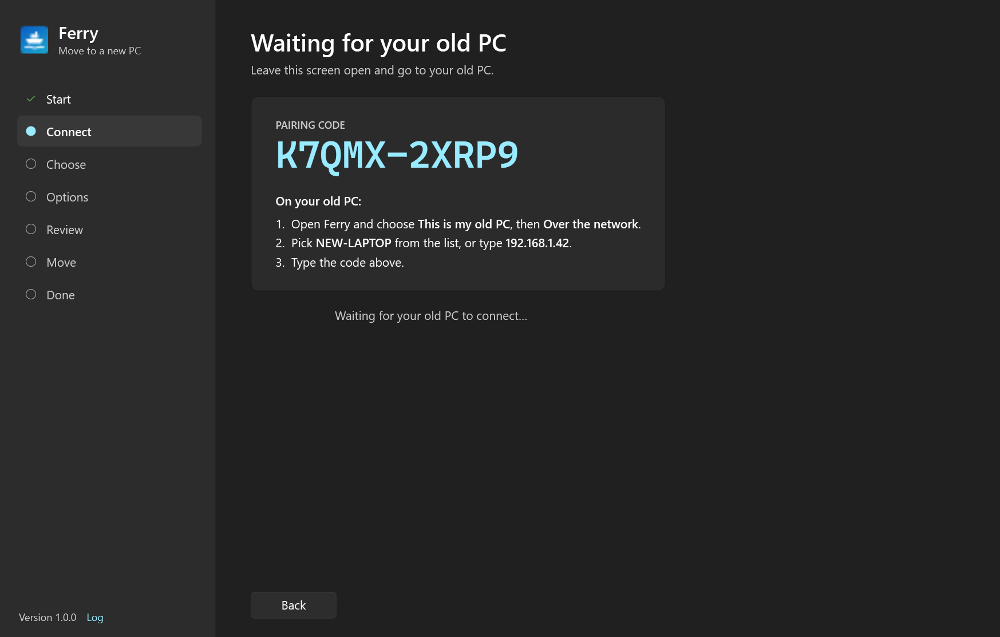
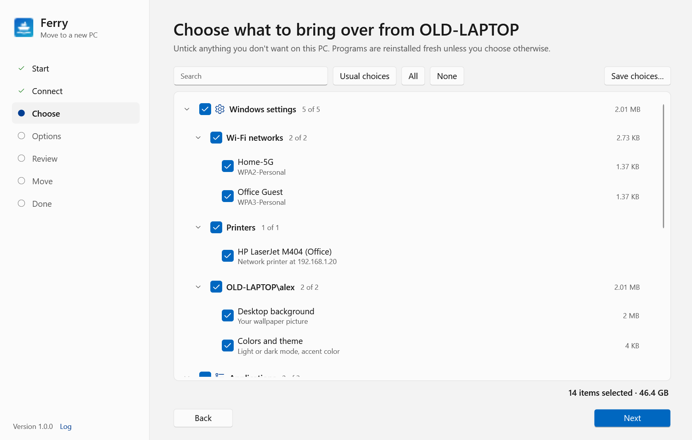
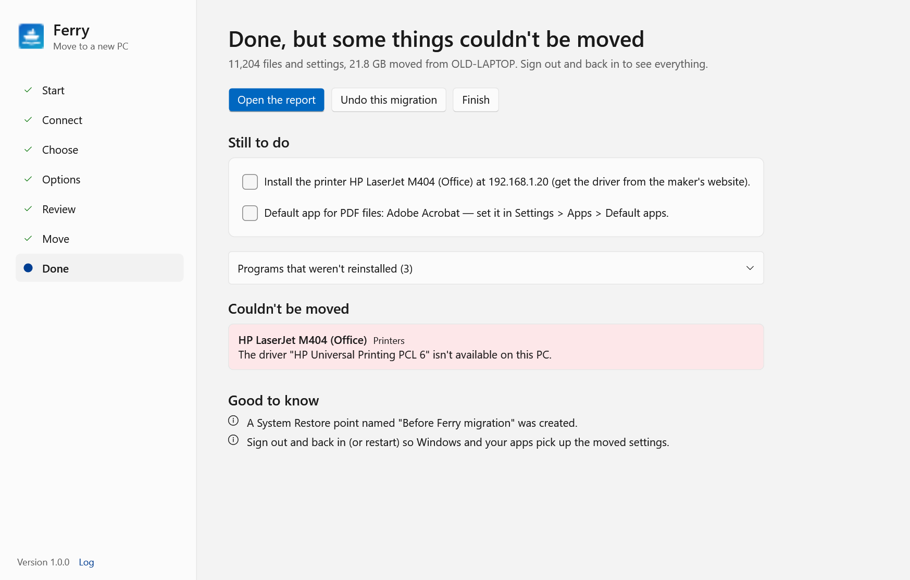

# Ferry

Ferry moves files, settings and programs from an old Windows PC to a new one — the same job as PCmover —
with a friendly wizard for people and a command line for IT to script it.



**Guides:** [Moving to a new PC](docs/user-guide.md) (step by step, for everyone) ·
[Ferry for IT](docs/it-deployment-guide.md) (silent migrations, plan files, user mapping, exit codes and reports)

## What it moves

| Area | What | How it lands on the new PC |
|---|---|---|
| **Files** | Desktop, Documents, Downloads, Pictures, Music, Videos, Favorites, Links, Saved Games…; other folders in the user profile (`.ssh`, `source`, …) and files in it (`.gitconfig`); non-system folders on any drive (`C:\Scans`, `D:\Projects`) and any folder you add | Into the new user's matching folders, wherever they are (OneDrive, redirected, another drive). Shortcuts are re-pointed at the new user's paths. |
| **Programs** | Everything in Add/Remove Programs and the Microsoft Store | **Reinstalled fresh with winget** by default (matched by winget, or by a built-in list of well-known apps). Optionally **copied as-is** — program folder, registry keys, file associations, COM classes, Start menu shortcuts and services (experimental). A full list goes in the report either way. |
| **Program settings** | Each vendor folder in AppData\Roaming (and, if ticked, AppData\Local) and each vendor key in `HKCU\Software` | Paths inside settings files and registry values are rewritten for the new user. |
| **Windows settings** | Wi-Fi networks (with passwords), shared and network printers, default printer, mapped drives, wallpaper, colors/theme, mouse/keyboard/touchpad, region and keyboard layouts, File Explorer and taskbar options, taskbar/Start pins, accessibility, fonts, user and system environment variables, default apps (listed for you to set) | Applied to the new user; system parts need administrator. |
| **Browsers & email** | Chrome, Edge, Brave, Vivaldi, Opera, Firefox profiles; Thunderbird | Bookmarks, history, extensions and settings. Firefox also brings saved passwords. |
| **Office & Outlook** | Signatures, `.pst` data files, templates (Normal.dotm), custom dictionaries/AutoCorrect, Excel/Word startup files (PERSONAL.XLSB), ribbon customizations, Sticky Notes | Into the same places; the report says where PSTs went so they can be opened in Outlook. |

## How it works

Run Ferry on both PCs (it runs from a USB stick; no install, no .NET needed).

**Over the network (recommended).** On the new PC choose *This is my new PC → Over the network*: it shows a
one-time pairing code. On the old PC choose *This is my old PC → Over the network*, pick the new PC from the list
and type the code. The old PC scans itself, you choose what to bring over **on the new PC**, and it streams across
and is applied as it arrives — programs install while files copy.



**With a migration file.** On the old PC choose *With a migration file*, pick what to move and where to save
(a USB drive, external disk or share), and set a password. On the new PC choose *From a migration file*.
Files on FAT32 drives are split into 4 GB parts automatically.



Before anything changes on the new PC you choose who gets whose data (old `PC\joe` → new `AzureAD\JoeSmith`),
what happens when a file already exists (keep both · keep the newer · replace · skip), and safety options
(System Restore point, close browsers/Office automatically, **dry run**).

When it's done you get a to-do list for what couldn't be done automatically, and an HTML report.



### Undo

Every change on the new PC is journaled under `%ProgramData%\Ferry\Undo` (`%LocalAppData%\Ferry\Undo` when not
elevated): files created, files replaced (the originals are moved aside), folders created, registry keys and values,
Wi-Fi profiles, printers, services and winget installs. *Undo a migration* reverses all of it, newest first.
Discard the undo data afterwards to free the space used by replaced files.

### Security

* Migration files can be encrypted: PBKDF2-SHA256 (600,000 iterations) → AES-256-GCM in authenticated segments,
  so tampering, reordering and truncation are all detected. Unencrypted files still carry a SHA-256 per file.
* Network transfers use an ephemeral ECDH (P-256) key exchange mixed with a key stretched from the 10-character
  pairing code (≈50 bits). A wrong code fails key confirmation before anything is sent; the code changes after
  every wrong attempt, and passive listeners learn nothing. Frames are AES-256-GCM with per-direction counters.
* On the new PC, Windows Firewall is opened for Ferry only while it waits, then closed again.

## Command line (`ferry-cli.exe`)

```text
ferry-cli scan [--all] [--details] [--json inventory.json]
ferry-cli capture --out D:\Ferry\joe.ferry --password [--plan plan.json] [--split auto|none|4GB]
ferry-cli restore --in D:\Ferry\joe.ferry --password [--map "OLDPC\joe=AzureAD\JoeSmith"] [--conflicts keepboth|newer|overwrite|skip] [--dry-run]
ferry-cli receive [--code ABCDE-FGHJK] [--plan plan.json] [--timeout 30]     # on the new PC
ferry-cli send --to NEWPC --code ABCDE-FGHJK [--plan plan.json]              # on the old PC
ferry-cli undo --list | <id> [--yes] | --discard <id>
ferry-cli info D:\Ferry\joe.ferry
ferry-cli plan --out plan.json [--from-scan]
```

Exit codes: `0` done · `2` some items failed · `3` stopped · `4` cancelled · `5` password problem · `64` bad arguments.
Passwords can also come from `--password-env VAR` or `--password-file F`. `--sandbox <dir>` runs a test restore that
writes files under `<dir>`, registry changes under `HKCU\Software\FerrySandbox`, and only logs installs and system
changes.

### Plan files (silent migrations)

A plan is JSON. Save one from the app (*Save choices…* on the choose screen) or start from `ferry-cli plan`:

```json
{
  "include": ["defaults", "name:Old Accounting*"],
  "skip": ["migrator:folders", "name:Downloads", "category:AppSettings"],
  "exclude": ["*.iso", "*.vhdx", "Downloads\\*.exe"],
  "apps": "winget",
  "conflicts": "KeepBoth",
  "userMap": { "OLDPC\\joe": "AzureAD\\JoeSmith" },
  "folderMap": { "D:\\Data": "C:\\Data" },
  "createRestorePoint": true,
  "closeApps": true
}
```

Selection rules: `all`, `defaults`, `category:<WindowsSettings|Applications|AppSettings|BrowsersAndEmail|Files>`,
`migrator:<wifi|printers|drives|personalization|fonts|defaultapps|apps|appdata|browsers|office|environment|files|folders>`,
`name:<glob>`, `group:<glob>`, `item:<id glob>`. Plans saved from the app wildcard user SIDs so they work on other PCs.

## Good to know

* **Run as administrator** for a full migration (the app offers to restart elevated). Without it only your own
  account is moved and Wi-Fi passwords, programs, printers and machine settings are skipped.
* **Sign in on the new PC first** as each person who'll use it, so their profile exists.
* **Chromium browsers lock saved passwords and cookies to the old PC.** Ferry leaves them out rather than copying
  data the new PC can't read: turn on browser sync (or export passwords) before switching. Firefox passwords move.
* **Default apps** can't be set by other programs on Windows 10/11; they're listed in the to-do list instead.
* **Copying programs is experimental.** Apps with drivers, licensing tied to hardware, or complex installers may not
  work; reinstall them if so. Kernel drivers are never copied.
* Files only in the cloud (OneDrive placeholders) are never downloaded; OneDrive-synced folders are unticked by
  default because OneDrive brings them back when you sign in.
* Files that are in use are read from a Volume Shadow Copy when running as administrator.
* Speed depends far more on the number of files than their size, because Windows security software scans each
  file as it's opened and written. Ferry reads and writes many small files at once to hide that, but folders like
  `node_modules` (often 100,000+ tiny files that `npm install` recreates) are worth leaving out:
  `--exclude node_modules`, or untick them in the app.

## Building

Requires the .NET 10 SDK on Windows.

```powershell
dotnet build Ferry.slnx
dotnet test tests\Ferry.Core.Tests
.\build\publish.ps1          # tests, then single-file Ferry.exe + ferry-cli.exe in dist\Ferry-<version>\
.\build\release.ps1          # from a clean commit: publish, zip, SHA-256 checksums, tag v<version>
.\build\make-icon.ps1        # regenerates src\Ferry.App\Assets\ferry.ico
```

`Ferry.exe --render-screens <folder>` renders every page with sample data to PNGs (light and dark), as a sample
PC rather than the one rendering them, so they can go straight into `docs/images`, and
`build\ui-smoke-test.ps1` drives the app through a save-and-dry-run with UI Automation.

### Layout

```text
src/Ferry.Core/
  Model/           inventory, options, results
  Engine/          MigrationEngine (scan → capture → restore), contexts, FileRestorer, Preflight, MigrationPlan
  Migrators/       one class per kind of thing: files, folders, apps (+ winget/copy), app settings,
                   Windows/ (Wi-Fi, printers, drives, personalization, environment, fonts, default apps),
                   Email/ (browsers, Office & Outlook)
  Packaging/       the .ferry format: writer, reader, encryption, split files
  Transport/       pairing, encrypted channel, LAN discovery, sender/receiver sessions
  Rollback/        change journal and undo
  Infrastructure/  registry hives and snapshots, path remapping, shadow copies, winget, shortcuts, logging
  Reporting/       HTML report
src/Ferry.App/     WPF wizard (Fluent theme, light/dark)
src/Ferry.Cli/     ferry-cli.exe
tests/             xUnit tests: packaging, crypto, network pairing, restore/undo, plans, parsing
```

Adding a new kind of data means adding an `IMigrator` (scan → items, capture → package entries, restore entries →
changes recorded in the journal) and listing it in `MigratorCatalog`.
