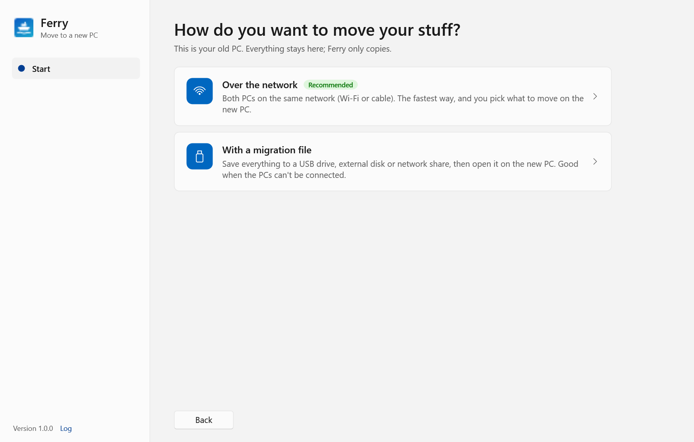
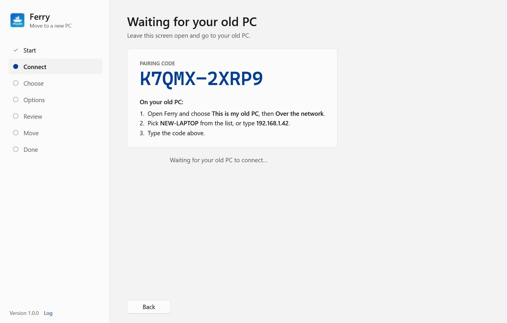
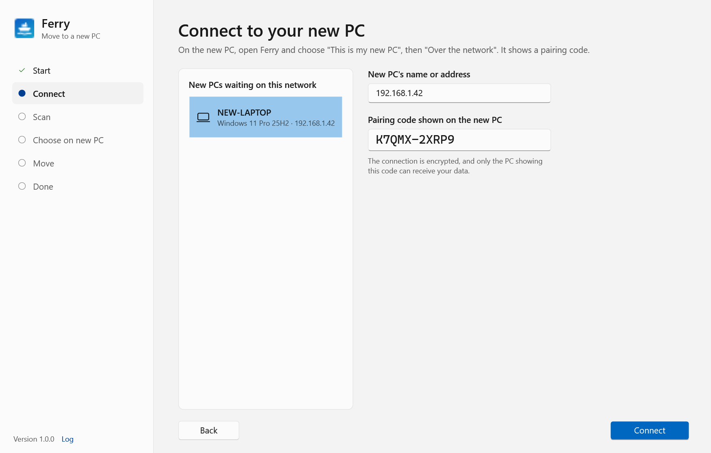
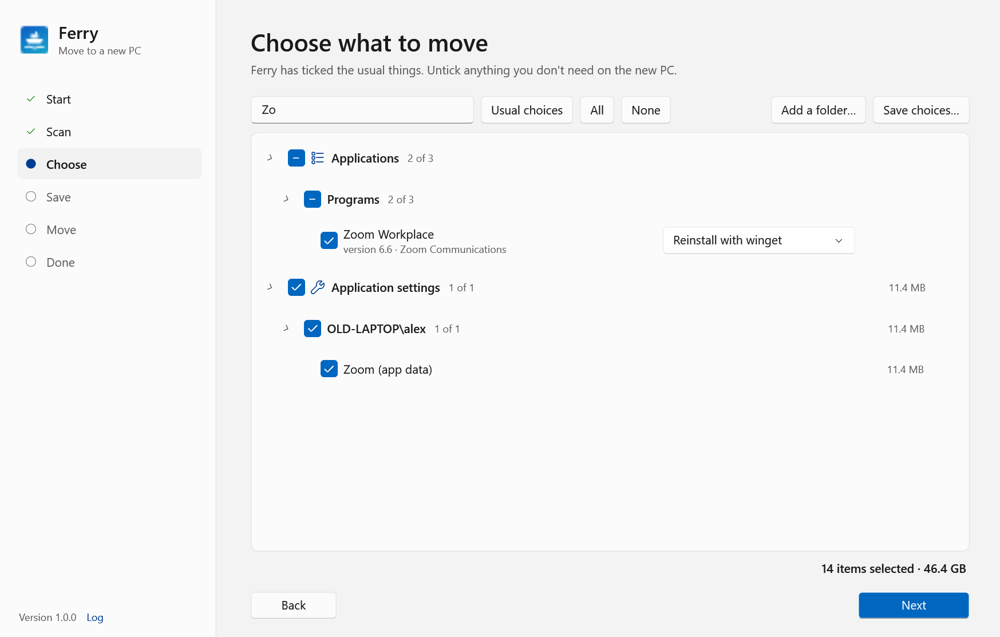
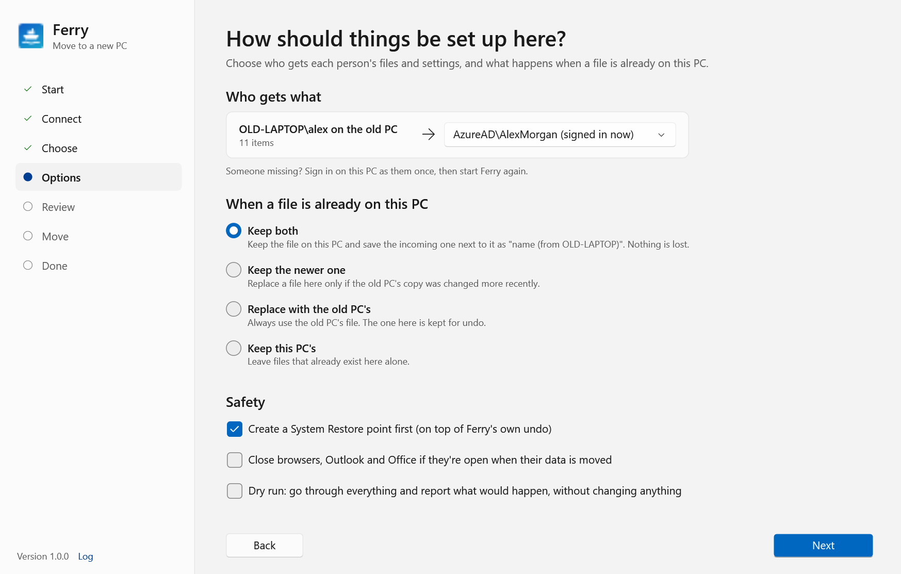
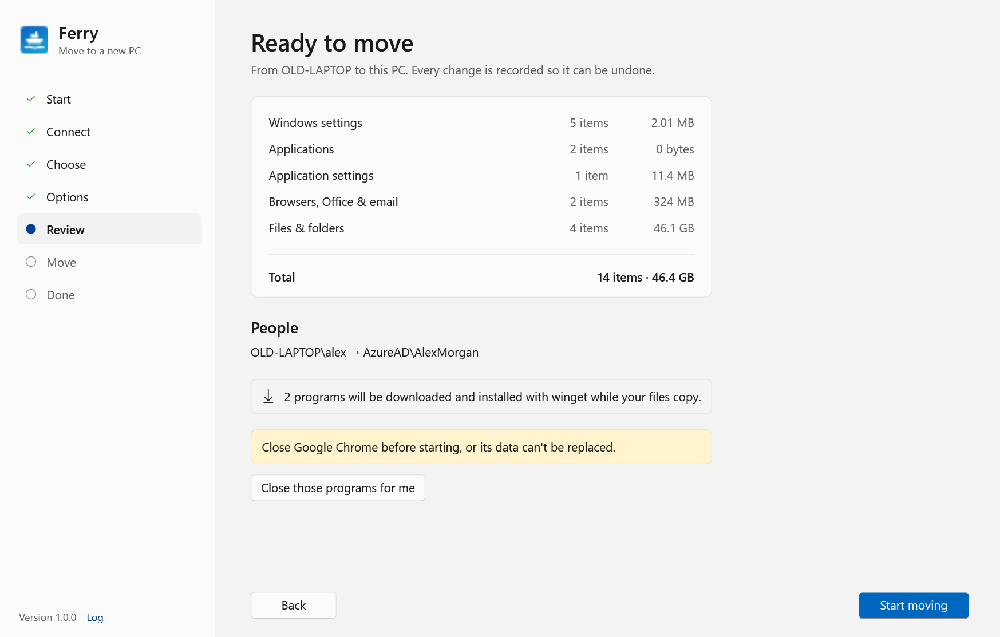
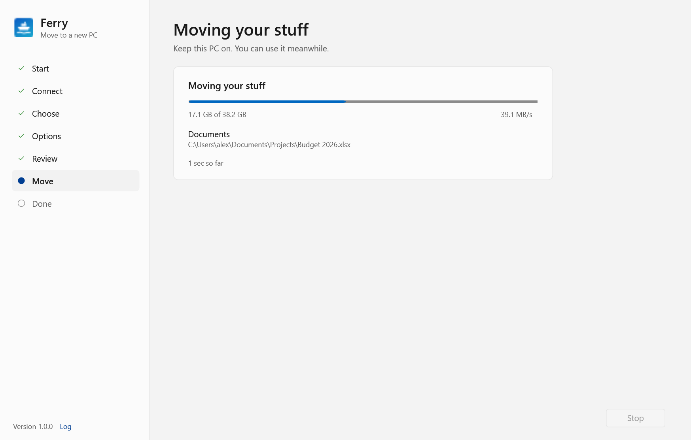
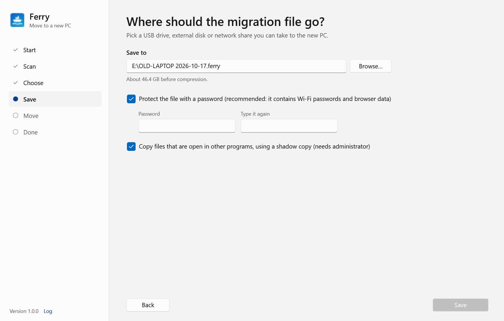
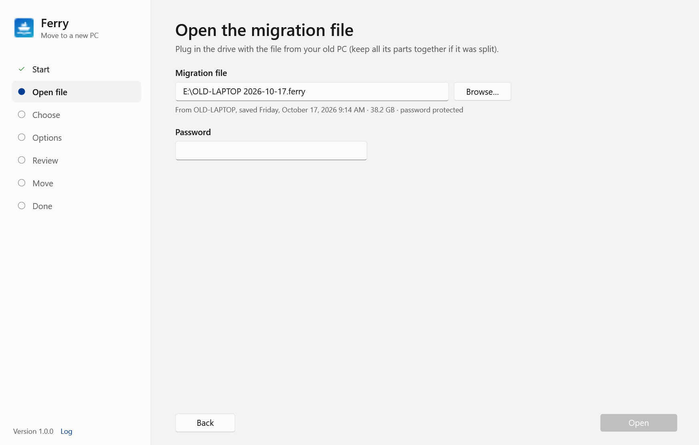
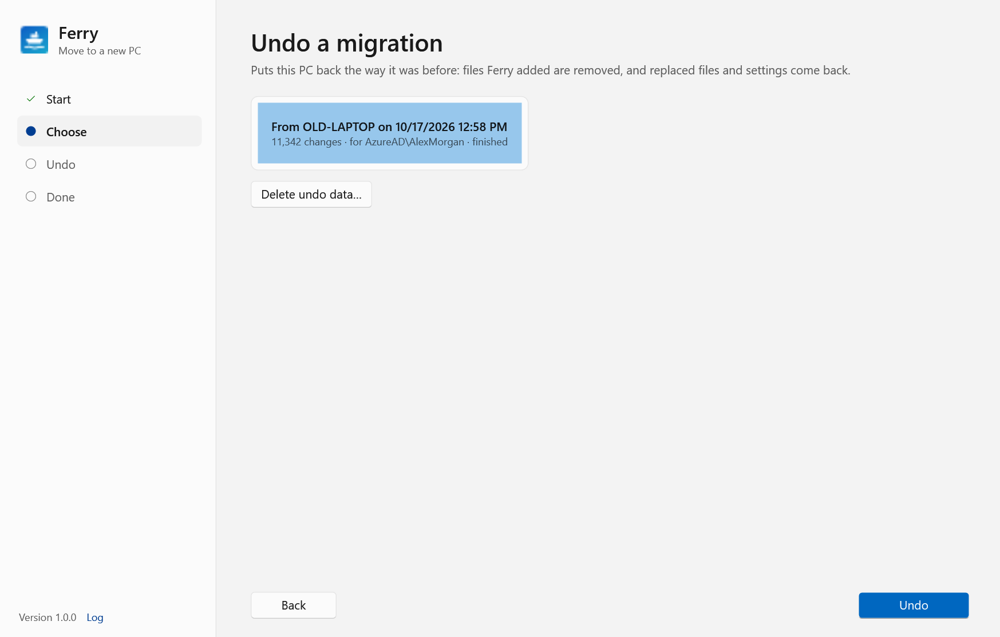

# Moving to a new PC with Ferry

This guide walks you through moving your files, settings and programs from your old Windows PC to a new one.
It takes about 10 minutes of your time. The copying itself can take from a few minutes to a few hours, depending on
how much you have.

* [Before you start](#before-you-start)
* [Pick a way to move](#pick-a-way-to-move)
* [Moving over the network](#moving-over-the-network-recommended) (recommended)
* [Moving with a migration file](#moving-with-a-migration-file)
* [After the move](#after-the-move)
* [Undoing a move](#undoing-a-move)
* [What moves, and what doesn't](#what-moves-and-what-doesnt)
* [If something goes wrong](#if-something-goes-wrong)

Setting up many PCs, or running Ferry without anyone clicking through it? See the
[IT deployment guide](it-deployment-guide.md).

---

## Before you start

**On the new PC**

1. **Sign in as each person who'll use it.** Ferry can only move someone's things into an account that has signed
   in at least once. If the new PC uses a work account (for example *AzureAD\AlexMorgan*), sign in with that.
2. **Connect it to the internet.** Ferry reinstalls your programs by downloading them fresh.
3. **Sign in to OneDrive** if you use it. Folders that OneDrive already keeps in sync come back on their own, so
   Ferry leaves them unticked.

**On the old PC**

1. **Turn on sync in Chrome, Edge or your other browser** (or export your saved passwords). Ferry moves your
   bookmarks, history, extensions and settings. Saved passwords and cookies in Chrome, Edge, Brave, Vivaldi and
   Opera only work on the PC that saved them, so they can't be moved. Firefox passwords do move.
2. **Close your programs**, especially browsers and Outlook, so their data is copied in one piece.

**On both PCs**

* **Plug them in.** Ferry stops the PC from going to sleep while it works, but closing a laptop's lid still puts it
  to sleep.
* **Get Ferry.** It's a single file, `Ferry.exe`, with nothing to install. Copy it to each PC or run it from a USB
  stick.
* **Run it as administrator.** Right-click `Ferry.exe` and choose **Run as administrator**, or click
  **Restart as administrator** in the yellow box Ferry shows. Without it, Ferry can only move your own files and
  settings. Programs, Wi-Fi networks, printers and other people's accounts are skipped.

> Ferry isn't code-signed yet, so Windows may show "Windows protected your PC" the first time. If you got Ferry
> from your IT team or built it yourself, choose **More info** → **Run anyway**.

## Pick a way to move

When you open Ferry you'll see this:

There are two ways to get your things across:

| | **Over the network** (recommended) | **With a migration file** |
|---|---|---|
| **Use it when** | Both PCs are on the same network, by Wi-Fi or cable. | The PCs can't be connected, or the old PC needs to go away first. |
| **You need** | Both PCs at the same time. | A USB drive, external disk or network share with enough space. |
| **Speed** | Fastest. Programs install while your files copy. | Copies everything twice: once to the file, once onto the new PC. |
| **You choose what to move** | On the new PC. | On the old PC, then again (optionally) on the new PC. |

After you say which PC you're on, Ferry asks which way you want:

---

## Moving over the network (recommended)

Start on the **new PC**, then go to the old one.

### 1. New PC: wait for the old PC

Open Ferry and choose **This is my new PC**, then **Over the network**. Ferry shows a pairing code. Leave this
screen open.

The code makes sure your data goes only to this PC. If someone types it wrong, Ferry shows a new code, so
check the screen again before typing it.

### 2. Old PC: connect to the new PC

Open Ferry and choose **This is my old PC**, then **Over the network**.

1. Pick your new PC from **New PCs waiting on this network**. If it isn't there, type the name or address shown on
   the new PC's screen into **New PC's name or address**.
2. Type the code from the new PC into **Pairing code shown on the new PC**. Capitals and dashes don't matter.
3. Click **Connect**.

The old PC now looks through its files, settings and programs. This can take a few minutes. When it's done, the
rest happens on the new PC. The old PC just waits, and you can keep using it.

### 3. New PC: choose what to bring over

Ferry has already ticked the usual things. Untick anything you don't want on the new PC.

* **Search** finds anything by name.
* **Usual choices**, **All** and **None** reset all the ticks at once.
* Programs are reinstalled with a fresh download by default. When a program can arrive more than one way, it
  has a dropdown: **Reinstall with winget** (the default and the safest choice) or **Copy program files
  (experimental)**, which copies the program as it is. Copying is for programs that can't be downloaded; programs
  that can't be downloaded are unticked until you choose to copy them.

  

* The total size is shown at the bottom right.

Click **Next**.

### 4. New PC: decide how things are set up

**Who gets what.** Each person from the old PC is matched with an account here. Ferry guesses by name, and
otherwise picks whoever is signed in now. Change it if the guess is wrong. Choose **Don't move this person's things**
to leave someone out. If the person isn't in the list, sign in as them on this PC once, then start Ferry again.

**When a file is already on this PC:**

| Choice | What happens |
|---|---|
| **Keep both** (default) | The file here stays, and the old PC's copy is saved next to it as "name (from OLD-PC)". Nothing is lost. |
| **Keep the newer one** | The file here is replaced only if the old PC's copy was changed more recently. |
| **Replace with the old PC's** | The old PC's copy always wins. The file that was here is kept, so it can be put back with undo. |
| **Keep this PC's** | Files that already exist here are left alone. |

Files that are exactly the same on both PCs are skipped whichever you choose.

**Safety**

* **Create a System Restore point first.** An extra safety net on top of Ferry's own undo. Windows only makes one
  restore point a day, so the report tells you if it was skipped.
* **Close browsers, Outlook and Office if they're open when their data is moved.** Without this, Ferry asks you
  to close them yourself.
* **Dry run.** Ferry goes through everything and reports what *would* happen, without changing anything. Use it
  if you want to see first.

Click **Next**.

### 5. New PC: check and start

This is the last look before anything changes. It shows:

* how much is coming over, and whose things go to which account;
* how many programs will be installed;
* anything that needs your attention, such as a program that's open. Click **Close those programs for me**, or
  close them yourself. Red warnings, such as not enough disk space, must be fixed before you can start.

Click **Start moving**.

### 6. Wait while it moves

Keep both PCs on and connected. You can keep using them. Programs install while files copy, so the last few
minutes may be spent on installs.

**Stop** halts the move. Whatever was moved so far stays, and you can undo it.

### 7. Done

The **Done** screen tells you what's left for you to do:

* **Still to do.** Things Ferry can't do for you, such as setting your default apps or installing a printer
  driver. Tick them off as you go.
* **Programs that weren't reinstalled.** Programs from the old PC that weren't ticked or couldn't be downloaded.
  Install the ones you still use.
* **Couldn't be moved.** Anything that failed, and why.
* **Open the report** shows the full details. The old PC gets its own copy of the report too.

**Sign out and back in** (or restart) so Windows and your programs pick up the moved settings. Then see
[After the move](#after-the-move).

---

## Moving with a migration file

### On the old PC: save the file

1. Plug in a USB drive or external disk with enough free space (or have a network share ready).
2. Open Ferry and choose **This is my old PC**, then **With a migration file**.
3. Ferry looks through the PC. This can take a few minutes.
4. **Choose what to move.** It works like [step 3 above](#3-new-pc-choose-what-to-bring-over). There's also
   **Add a folder…** for folders Ferry didn't find on its own, for example `D:\Projects`.
5. **Where should the migration file go?**

   

   * **Save to:** pick your USB drive, disk or share with **Browse…**. If the drive is formatted FAT32 (common on
     USB sticks), Ferry splits the file into 4 GB parts. Keep all the parts together in the same folder.
   * **Protect the file with a password.** Strongly recommended: the file contains your Wi-Fi passwords and
     browser data. Use at least 6 characters, and don't lose it. **The password can't be recovered.**
   * **Copy files that are open in other programs, using a shadow copy.** Lets Ferry copy files that are in use.
     Needs administrator.
6. Click **Save** and wait. When it's done, Ferry says where the file is.

### On the new PC: open the file

1. Plug in the drive with the file.
2. Open Ferry and choose **This is my new PC**, then **From a migration file**.
3. Ferry looks for the newest migration file at the top of each drive, in a `Ferry` folder on each drive, and in
   `Documents\Ferry`. If it doesn't find yours, click **Browse…**. Type the password and click **Open**.

   

4. Carry on from [step 3 above](#3-new-pc-choose-what-to-bring-over): everything in the file is ticked, and you
   can untick anything you don't want here.

When you're finished, delete the migration file, or keep it somewhere safe. It holds a copy of everything,
including Wi-Fi passwords.

---

## After the move

Work through the **Still to do** list on the Done screen, then:

* **Browsers.** Open each one and sign in to turn sync back on. Your passwords and logins come back from sync.
* **Outlook.** If you had `.pst` data files, the report says where they were put. In Outlook, choose
  **File** → **Open & Export** → **Open Outlook Data File** to add them back. Your signatures are already in place.
* **Default apps.** Windows doesn't let other programs change them. The list shows what you used before. Set them
  in **Settings** → **Apps** → **Default apps**.
* **Printers.** Network printers are added for you when Windows has a driver. For any others, the list says which
  printer and where it is.
* **Programs.** Open each reinstalled program once. Some ask you to sign in or enter a licence key again.
* **Check your files** in Documents, Pictures and the other folders.

When you're happy with everything, you can [delete the undo data](#undoing-a-move) to free up space.

## Undoing a move

Ferry records every change it makes on the new PC, so a move can be reversed.

1. Open Ferry on the new PC and choose **Undo a migration** (or click **Undo this migration** on the Done screen).
2. Pick the move to undo and click **Undo**.

Undo removes the files Ferry added (**including any changes you've made to them since**), puts back files and
settings it replaced, and uninstalls the programs it installed. Sign out and back in afterwards.

If undo stops partway, or a step fails, just run it again. It carries on where it left off.

**Delete undo data…** throws away the record of a move, and the copies of any files it replaced. That frees up
space, but the move can no longer be undone.

## What moves, and what doesn't

| Moves | Doesn't move |
|---|---|
| Documents, Desktop, Pictures, Music, Videos, Downloads and other folders in your user folder, plus folders on other drives you add | Files stored only in OneDrive's cloud (OneDrive brings them back when you sign in) |
| Programs: reinstalled fresh, or copied as they are (experimental) | Programs with drivers or hardware-tied licences when copied. Reinstall those yourself. |
| Program settings in your user folder and registry | |
| Wi-Fi networks and their passwords, printers, mapped drives | Printer drivers that aren't available on the new PC |
| Wallpaper, colors, mouse and keyboard settings, taskbar and Start pins, fonts, accessibility options | Default apps (listed for you to set) |
| Browser bookmarks, history, extensions and settings. Firefox passwords too. | Saved passwords and cookies in Chrome, Edge, Brave, Vivaldi and Opera |
| Outlook signatures and `.pst` files, Office templates, dictionaries, Sticky Notes | Your email itself: it comes back from the mail server when you sign in |

## If something goes wrong

**The new PC doesn't show up in the list on the old PC.**
Type the new PC's name or address (shown on its screen) into **New PC's name or address**. If that doesn't work
either, check that both PCs are on the same network and not a guest or public Wi-Fi network (those often block PCs
from seeing each other). Disconnect from any VPN. If all else fails, use a migration file.

**"Pairing failed" or the code doesn't work.**
After a wrong code, the new PC shows a fresh one. Type the code that's on the screen now.

**"Not running as administrator."**
Close Ferry and open it again with right-click → **Run as administrator**, or click **Restart as administrator**.
Do this on both PCs.

**Someone is missing from "Who gets what".**
Sign in on the new PC as that person once, sign out, then start Ferry again.

**It says there isn't enough space.**
Untick large folders you don't need, such as **Downloads**, or free up space on the new PC (or the drive you're
saving to).

**It's slow.**
Speed depends far more on the number of files than on their size, because security software checks each file.
Folders with huge numbers of tiny files are the slowest. If you're a developer, untick `node_modules` folders:
they're easy to recreate.

**The move stopped partway.**
What was moved so far stays on the new PC. Either undo it, or run Ferry again. Files that already arrived are
skipped, because they're identical.

**I forgot the migration file's password.**
It can't be recovered. Save a new migration file on the old PC.

**Where are the reports and logs?**
On the home screen, click **Past reports**. The **Log** link at the bottom left opens Ferry's log, which helps if
you need to ask for help. They're kept in `C:\ProgramData\Ferry` when Ferry runs as administrator, otherwise in
`%LocalAppData%\Ferry`.
